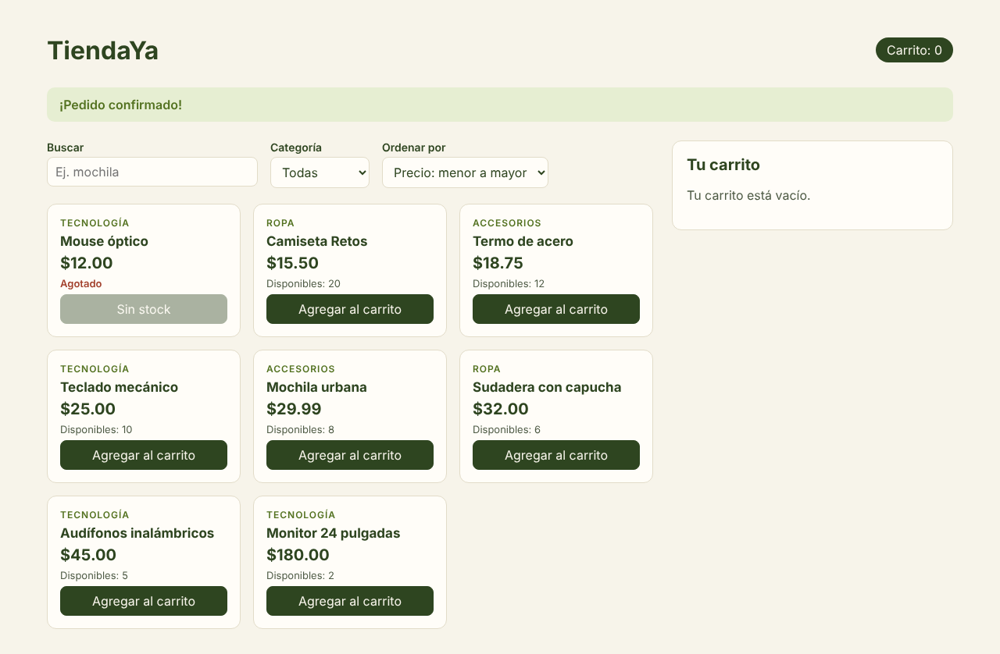

# TiendaYa · Proyecto de pruebas

TiendaYa es una tienda en línea de práctica hecha con Next.js para el **Módulo 21: Aplicación de Testing y QA** del Instituto RETOS. Tiene catálogo, buscador, carrito con cupones, cálculo de IVA y envío, formulario de compra y una pasarela de pago simulada. Trae **pruebas unitarias** de toda la lógica, **pruebas de componentes** de la interfaz y una serie de **retos** para seguir practicando.



## Cómo empezar

Necesitas Node.js 18.18 o más reciente y VS Code.

```bash
npm install     # instala Next.js, React y Jest
npm test        # ejecuta todas las pruebas
npm run dev     # abre la tienda en http://localhost:3000
```

| Comando | Qué hace |
| --- | --- |
| `npm test` | Ejecuta todas las pruebas |
| `npm run test:unit` | Solo las pruebas unitarias (`tests/unit`) |
| `npm run test:components` | Solo las pruebas de componentes (`tests/components`) |
| `npm test -- carrito` | Solo los archivos cuyo nombre contiene "carrito" |
| `npm run test:watch` | Vuelve a ejecutar las pruebas cada vez que guardas |
| `npm run test:coverage` | Muestra la cobertura y crea el reporte en `coverage/` |

## Estructura

El proyecto separa la lógica de la interfaz. Así cada capa se prueba con la técnica que le corresponde.

```
tiendaya/
├── src/
│   ├── app/                     Página de Next.js (solo muestra <Tienda />)
│   ├── components/              Interfaz en React
│   │   ├── Tienda.jsx           Guarda el estado y conecta todo
│   │   ├── FiltroProductos.jsx  Buscador, categoría y orden
│   │   ├── ListaProductos.jsx   Lista de tarjetas
│   │   ├── TarjetaProducto.jsx  Un producto con su botón "Agregar"
│   │   ├── ResumenCarrito.jsx   Productos, cupón y totales
│   │   └── FormularioCheckout.jsx  Datos de entrega
│   ├── lib/                     Lógica de negocio: funciones puras, sin React
│   │   ├── precios.js           IVA, cupones, envío y formato de moneda
│   │   ├── carrito.js           Agregar, quitar, cambiar cantidad y totales
│   │   ├── catalogo.js          Buscar, filtrar y ordenar productos
│   │   ├── validaciones.js      Validación del formulario de compra
│   │   └── pedidos.js           Confirmar pedidos y estados del pedido
│   ├── services/
│   │   └── serviciosSimulados.js  Pasarela de pago y correo de mentira
│   └── data/
│       └── productos.js         Catálogo de ejemplo
├── tests/
│   ├── unit/                    Pruebas unitarias de src/lib
│   └── components/              Pruebas de componentes de src/components
├── jest.config.js
└── jest.setup.js
```

| Capa | Qué contiene | Cómo se prueba |
| --- | --- | --- |
| `src/lib` | Reglas del negocio | Pruebas unitarias: entradas y salidas, sin navegador |
| `src/services` | Dependencias externas (pago, correo) | Se reemplazan por dobles con `jest.fn()` |
| `src/components` | Lo que ve el usuario | Pruebas de componentes con React Testing Library |
| `Tienda.jsx` | Todos los componentes juntos | Prueba de integración de componentes |

## Reglas del negocio

Estas son las reglas que las pruebas verifican. Úsalas como requisitos para diseñar tus casos.

- **IVA:** 13 % sobre el monto después del descuento, redondeado a dos decimales.
- **Cupones:** `RETOS10` da 10 % y `RETOS20` da 20 %. No importan las mayúsculas ni los espacios.
- **Envío:** cuesta $5. Es gratis si el monto después del descuento es de $50 o más, o si el cliente es premium.
- **Stock:** no se pueden agregar más unidades de las disponibles. Un producto con stock 0 aparece como agotado.
- **Formulario:** el nombre necesita al menos 3 letras, el correo debe tener formato válido y el código postal exactamente 4 dígitos.
- **Pedido:** solo se cobra si el carrito tiene productos. Si el pago se aprueba, se envía un correo y el pedido pasa a "Pagado"; si se rechaza, el carrito se conserva.
- **Estados del pedido:** Creado → Pagado → Enviado → Entregado. Se puede cancelar desde Creado o Pagado.

## Qué pruebas trae

| Archivo | Qué prueba | Técnica de la clase |
| --- | --- | --- |
| `unit/precios.test.js` | IVA, cupones, envío, formato | Valores límite ($49.99 y $50), `test.each` |
| `unit/carrito.test.js` | Agregar, quitar, cantidades, totales | Funciones puras, límite de stock |
| `unit/catalogo.test.js` | Buscar, filtrar, ordenar | Casos borde, inmutabilidad |
| `unit/validaciones.test.js` | Formulario de compra | Particiones de equivalencia y valores límite |
| `unit/pedidos.test.js` | Confirmar pedido y estados | Stubs y mocks, transición de estados |
| `components/TarjetaProducto.test.jsx` | Datos del producto y botón | `render`, `getByRole`, `fireEvent` |
| `components/ListaProductos.test.jsx` | Lista y mensaje vacío | `getAllByRole`, `queryByRole` |
| `components/FiltroProductos.test.jsx` | Buscador y selectores | `getByLabelText`, `fireEvent.change` |
| `components/ResumenCarrito.test.jsx` | Totales, cupón, quitar | Componentes con callbacks simulados |
| `components/FormularioCheckout.test.jsx` | Errores y envío | Validación en la interfaz |
| `components/Tienda.test.jsx` | Compra completa | Integración con servicios simulados |

## Retos

Trabaja cada reto con el ciclo TDD: **primero escribe la prueba y mira que falle (rojo), luego escribe el código mínimo para que pase (verde) y después mejora el código (refactor).** Al terminar, `npm test` debe quedar todo en verde.

### Nivel 1 · Pruebas unitarias

**Reto 1 · Cupón de envío gratis.** Agrega el cupón `ENVIOGRATIS`, que no descuenta dinero pero deja el envío en $0.
- Dónde: `src/lib/precios.js`, `src/lib/carrito.js` y `tests/unit/carrito.test.js`.
- Listo cuando: una camiseta de $15.50 con `ENVIOGRATIS` da un total de $17.52.

**Reto 2 · Límite por producto.** Nadie puede comprar más de 5 unidades del mismo producto, aunque haya más stock.
- Dónde: `agregarItem` y `cambiarCantidad` en `src/lib/carrito.js`.
- Pista: prueba los valores límite 5 y 6.

**Reto 3 · Teléfono opcional.** Agrega el campo `telefono` a `validarCheckout`. Es opcional, pero si se escribe debe tener exactamente 8 dígitos.
- Pista: son tres particiones: vacío (válido), 8 dígitos (válido) y cualquier otra cosa (inválido).

**Reto 4 · Productos disponibles.** Escribe `soloDisponibles(productos)` en `src/lib/catalogo.js`, que devuelva solo los productos con stock mayor que 0.
- Listo cuando: sus pruebas comprueban que no modifica la lista original.

**Reto 5 · Puntos de lealtad (kata TDD).** Escribe `calcularPuntos(total)` en un archivo nuevo `src/lib/lealtad.js`: 1 punto por cada $10 completos de compra.
- Casos para empezar: $9.99 da 0 puntos, $10 da 1 y $85.29 da 8.
- Extra: los clientes premium reciben el doble de puntos.

### Nivel 2 · Pruebas de componentes

**Reto 6 · Últimas unidades.** `TarjetaProducto` debe mostrar "¡Últimas unidades!" cuando el stock es de 1 a 3.
- Pista: prueba los valores límite 0, 1, 3 y 4.

**Reto 7 · Vaciar carrito.** Agrega un botón "Vaciar carrito" en `ResumenCarrito` que llame a una nueva función `onVaciar`.
- Listo cuando: hay una prueba del componente con `jest.fn()` y otra en `Tienda.test.jsx` que comprueba que el contador vuelve a "Carrito: 0".

**Reto 8 · Filtro de disponibles.** Agrega a `FiltroProductos` una casilla "Solo disponibles" que use la función del reto 4.
- Pista: con `fireEvent.click` sobre la casilla, la lista no debe mostrar el "Mouse óptico".

**Reto 9 · Cupón con Enter.** Escribe una prueba que demuestre que el cupón también se aplica al presionar Enter en el campo, sin hacer clic en "Aplicar".
- Pista: busca cómo enviar un formulario con `fireEvent.submit`.

**Reto 10 · Errores que desaparecen.** En `FormularioCheckout`, el error de un campo debe desaparecer en cuanto el usuario lo corrige, sin volver a enviar.
- Listo cuando: hay una prueba que escribe un correo inválido, envía, lo corrige y comprueba con `queryByRole('alert')` que el error ya no está.

### Nivel 3 · Dobles de prueba y estados

**Reto 11 · Pasarela caída.** Si `pasarela.cobrar` lanza un error (por ejemplo, sin conexión), `confirmarPedido` debe devolver el mensaje "No pudimos procesar el pago, intenta de nuevo" y no enviar correo.
- Pista: en la prueba usa `jest.fn(() => { throw new Error('Sin conexión'); })`.

**Reto 12 · Descontar inventario.** Agrega un tercer servicio, `inventario`, con un método `descontar(items)`. Debe llamarse solo cuando el pago se aprueba.
- Listo cuando: dos pruebas con un mock comprueban que se llama al aprobar y no se llama al rechazar.

**Reto 13 · Devoluciones.** Agrega el estado "Devuelto", al que solo se llega desde "Entregado" con el evento `devolver`.
- Listo cuando: hay una prueba de la transición válida y otra que demuestra que un pedido "Pagado" no se puede devolver.

### Nivel 4 · Calidad del proyecto

**Reto 14 · Cobertura.** Ejecuta `npm run test:coverage`, abre `coverage/lcov-report/index.html` y busca las líneas o ramas sin probar. Escribe las pruebas que falten hasta llegar a 95 % o más en `src/lib`.

**Reto 15 · Caza de mutantes.** Cambia a propósito una regla, por ejemplo `>=` por `>` en `costoEnvio`, o `0.13` por `0.12` en el IVA. Ejecuta las pruebas: si ninguna falla, encontraste un hueco. Escribe la prueba que lo cubre y deshaz el cambio.

**Reto 16 · Reporta lo que encuentres.** Si al resolver un reto descubres un comportamiento que no coincide con las reglas del negocio, regístralo como defecto en Jira o GitHub Issues con la plantilla de clase: título, entorno, pasos, resultado esperado, resultado obtenido, severidad y prioridad.

## Consejos

- Lee primero la prueba que ya existe más parecida a lo que necesitas y úsala de modelo.
- Una prueba debe revisar un solo comportamiento y su nombre debe decir qué se espera.
- En las pruebas de componentes, busca los elementos como los buscaría el usuario: por su texto, su etiqueta o su rol (`getByRole`, `getByLabelText`), no por clases de CSS.
- Si una prueba pasa en el primer intento, rompe el código un momento para confirmar que la prueba sí detecta el error.
